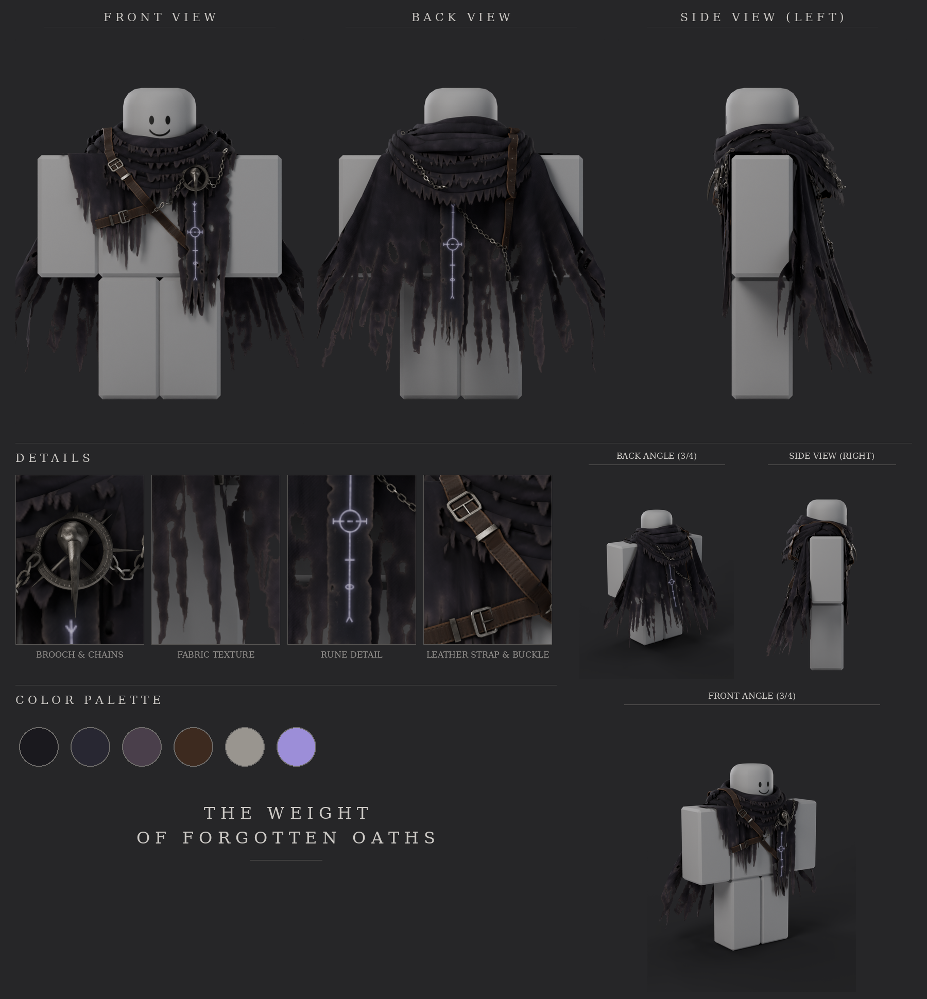

# The Weight of Forgotten Oaths: R6 cloak

A tattered black cloak for Roblox R6 characters, built from the concept sheet in
`reference/concept_sheet.png`. It includes a lowered hood and wrapped scarf, a torn floor-length
cape, rune banners front and back, a spiked raven-skull brooch, chains, a leather bandolier with
buckles, and an O-ring with a hanging tag. Everything is fitted to the supplied mannequin
(`reference/R6_mannequin.obj`).



`renders/reference_comparison.png` shows each concept view next to the matching render. All
renders use only the exported texture maps at Roblox resolution (1024²).

## Contents

| Path | What it is |
| --- | --- |
| `export/ForgottenOathsCloak.fbx` | Four meshes for Roblox: studs, Y up, facing −Z, positioned relative to the Torso centre. Includes tangents and embedded textures. |
| `export/ForgottenOathsCloak.obj` + `.mtl` | The same geometry as OBJ. |
| `export/ForgottenOathsCloak.glb` | glTF with full PBR materials, for previews and other tools. It follows the glTF convention of facing +Z, so use the FBX or OBJ for Roblox. |
| `export/ForgottenOathsCloak_source.blend` | Blender 4.5 scene with the four meshes and materials. |
| `export/roblox_parts.json` | Per-part triangle counts, sizes and Torso offsets. |
| `textures/roblox_1024/` | Roblox-ready PBR maps (1024²). |
| `textures/source_2048/` | The same maps at 2048². |
| `roblox/ForgottenOathsCloakSetup.lua` | Studio command-bar script that builds the Accessory. |
| `renders/` | Turnaround, details and the reference comparison. |
| `src/`, `build.sh` | The procedural generator that rebuilds everything above. |

## Meshes

| MeshPart | Triangles | Size (studs) | Offset from Torso centre | Texture set |
| --- | ---: | --- | --- | --- |
| CloakCape | 13,320 | 5.53 × 3.73 × 1.78 | (0.01, −0.78, 1.00) | Fabric |
| CloakCowl | 11,004 | 2.49 × 1.54 × 2.16 | (0.00, 0.87, 0.27) | Fabric |
| CloakDrapes | 7,748 | 3.14 × 3.14 × 2.34 | (0.15, −0.51, 0.47) | Fabric |
| CloakHardware | 14,236 | 2.17 × 2.51 × 2.27 | (−0.03, 0.20, 0.23) | Hardware |

Every part is under Roblox's 20,000-triangle limit per mesh. The cloth is modelled double-sided
(Roblox culls back faces), and the tears and holes come from the colour map's alpha channel.

**Fabric** maps (cape, cowl, drapes) are `Cloak_Fabric_Color` (RGBA; alpha holds the tears),
`_Normal` (OpenGL tangent space), `_Roughness` and `_Emissive` (the rune glow mask).
**Hardware** maps are `Cloak_Hardware_Color`, `_Normal`, `_Roughness` and `_Metalness`.

## Using it in Roblox Studio

1. Import `export/ForgottenOathsCloak.fbx` with the 3D Importer, keeping **Scale Unit: Studs**.
   You get a model containing `CloakCape`, `CloakCowl`, `CloakDrapes` and `CloakHardware`.
2. Upload the eight PNGs in `textures/roblox_1024` (Asset Manager → Bulk Import) and paste their
   asset ids into `TEXTURES` at the top of `roblox/ForgottenOathsCloakSetup.lua`.
3. Select the imported model (and optionally an R6 rig), paste the script into the command bar
   and run it. It creates `ServerStorage.ForgottenOathsCloak`, an Accessory whose `Handle` is the
   cape with a `BodyBackAttachment`. If a rig is selected, it also equips the cloak on it. The
   script sets each part's exact size, so a wrong import scale is corrected automatically.
4. To equip it at runtime: `humanoid:AddAccessory(ServerStorage.ForgottenOathsCloak:Clone())`.

To set things up by hand instead, give each MeshPart a SurfaceAppearance. Fabric parts use
**AlphaMode = Transparency** (with `MeshPart.Transparency = 0`), the emissive mask with a
lavender tint (199, 178, 255) and **EmissiveStrength ≈ 2**. The hardware part uses the four
hardware maps. Weld every part to the Torso at the offsets in the table above.

## Notes

- This is an in-experience asset at about 46k triangles in total. It exceeds the Marketplace UGC
  limits (4k triangles, 256² textures).
- Like any rigid R6 cape, the arms and legs swing through it during the default walk animation.
- The setup script and the import into Studio have not been run in Roblox; this environment has no
  Studio. The exported FBX and OBJ were re-imported in Blender and match the table above exactly
  (`src/verify_export.py`).

## Rebuilding

Requirements: Blender 4.5 LTS, plus Python 3 with `numpy`, `scipy`, `opencv-python-headless`
and `Pillow`.

```bash
BLENDER=/path/to/blender ./build.sh          # SAMPLES, VIEW_W/VIEW_H, DETAIL_W tune the renders
```

The pipeline steps are `make_masks.py` (tatter and hole masks), `build_scene.py` (geometry,
hardware, occlusion bakes), `make_textures.py` (PBR maps), `export.py` and
`make_roblox_script.py`, `verify_export.py`, then the renders. Shapes, tears and colours are all
parameters in `src/cloakgen/`.
